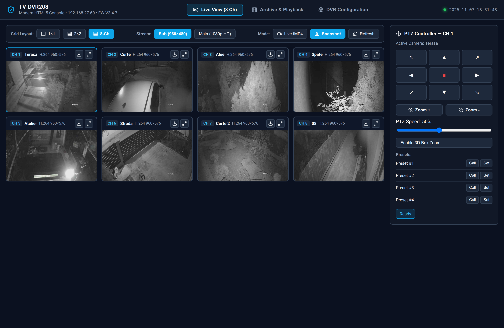
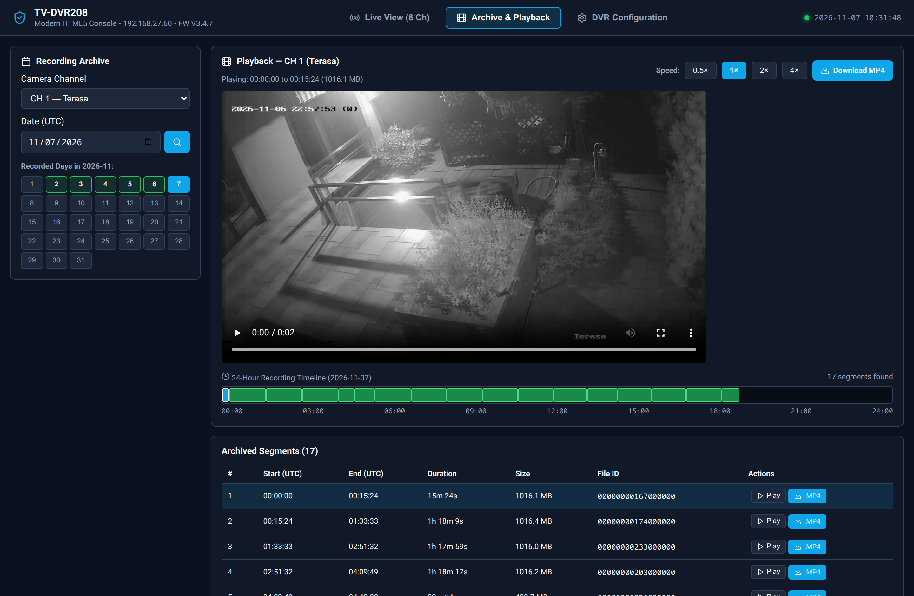
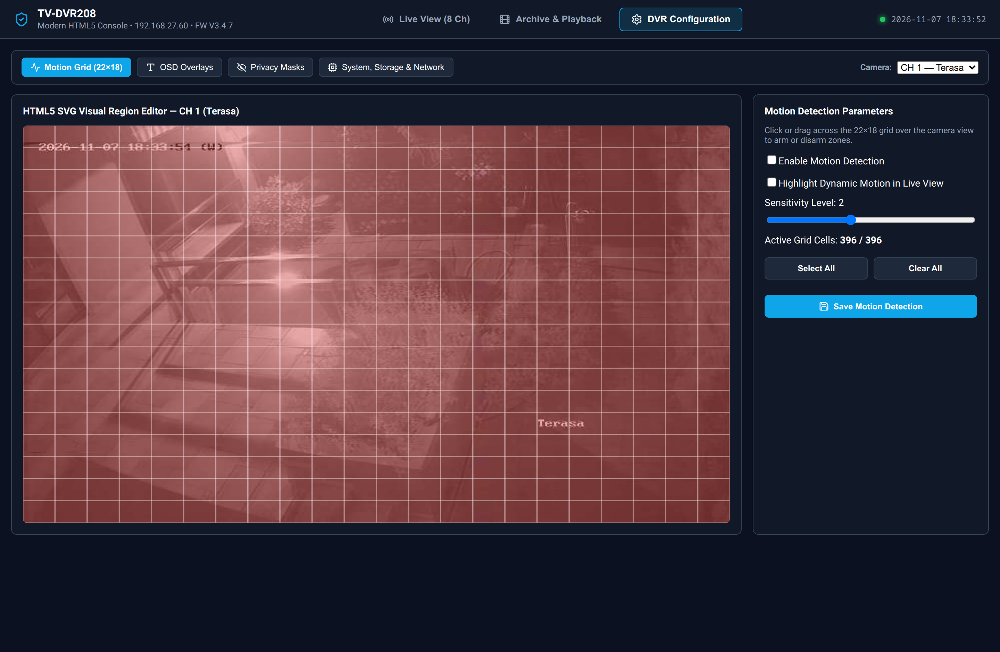
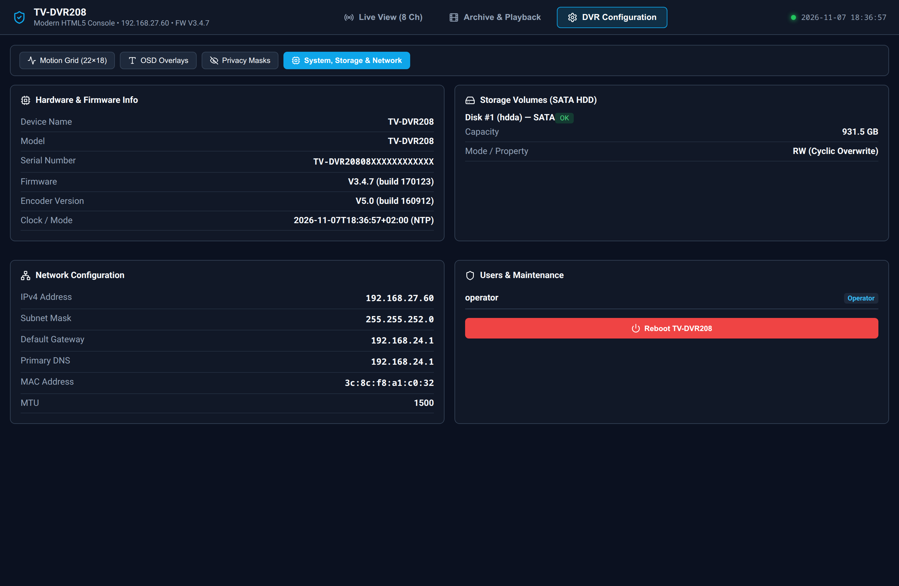

# TV-DVR208 Modern HTML5 Console & Hexagonal Gateway

A zero-plugin, single-binary HTML5 replacement for the legacy NPAPI/ActiveX web interface (`VideoStream.exe` / `libNPVideoPlugin.so`) of the **TRENDnet TV-DVR208** (Hikvision-OEM 8-Channel HD-TVI DVR, Firmware `V3.4.7`).

Built using **Hexagonal Architecture (Ports & Adapters)** in both the Go backend and the React + TypeScript frontend, compiled into a single self-contained binary via `embed.FS`.

---

## Screenshots

### 1. Multi-Camera Live View & PTZ Telemetry
Real-time 8-channel / 2×2 / 1×1 camera grid with zero-transcode fragmented MP4 (`fMP4`) streaming, 1080p instant JPEG snapshots, continuous Pan/Tilt/Zoom controls, presets, and 3D Box Zoom overlay.



### 2. Recording Archive, 24-Hour Timeline & Lossless MP4 Export
Monthly recording calendar, interactive 24-hour recording timeline scrubber, variable-speed playback (`0.5×` – `4×`), and one-click lossless `.mp4` clip download powered by automatic 40-byte Hikvision `IMKH` header stripping.



### 3. Interactive 22×18 SVG Motion Detection Grid & OSD Configuration
Visual editor for the DVR's `22×18` Hikvision motion detection bitmask grid (`gridMap` hex codec), OSD text/timestamp overlays (`704×576` normalized coordinate space), and privacy masks.



### 4. System, Storage & Network Inspector
Live hardware telemetry from `/ISAPI/System/deviceInfo`, `/ISAPI/ContentMgmt/Storage/hdd`, `/ISAPI/System/Network/interfaces/1`, and `/ISAPI/Security/users`.



---

## Key Features & Reverse-Engineered Capabilities

- **Zero-Plugin Live Video (`fMP4`)**: Remuxes the DVR's H.264 RTSP main (`101`–`801`, 1080p) and sub (`102`–`802`, 960×480) streams on the fly (`-c:v copy`) into browser-native fragmented MP4—zero CPU transcoding overhead.
- **High-Speed Archive Playback & Lossless `.MP4` Export**: Reverse-engineered in Ghidra from `libNPVideoPlugin.so` (`FUN_1000f4a0`), the gateway downloads raw recordings via `POST /ISAPI/ContentMgmt/download`, strips the proprietary **40-byte Hikvision `IMKH` (`0x484B4D49`) system header** to expose the clean MPEG-2 Program Stream (`0x000001BA`), and remuxes directly to standard `.mp4` at `>10 MB/s`.
- **Smart Browser Socket Management**: Automatically tears down `<video>` streams on unmount/navigation and caps concurrent live streams so the browser's 6-connection-per-origin HTTP/1.1 pool is never exhausted.
- **RFC 2617 HTTP Digest Authentication**: Outbound ISAPI adapter (`DigestTransport`) handles challenge-response nonce caching and automatic replay transparently.
- **Full PTZ & 3D Box Zoom**: Supports continuous Pan/Tilt/Zoom (`/ISAPI/PTZCtrl/channels/{id}/continuous`), presets (`1`–`255`), and drag-to-zoom 3D positioning (`/ISAPI/PTZCtrl/channels/{id}/position3D`).

---

## Architecture

```
┌────────────────────────────────────────────────────────────────────────────┐
│                        Browser (React 18 + TypeScript)                     │
│  ┌──────────────────────┐   ┌───────────────────┐   ┌───────────────────┐  │
│  │ UI Driving Adapters  │──▶│   DvrApiPort      │──▶│  HttpDvrAdapter   │  │
│  │ Live / Archive / Cfg │   │ (Inbound/Outbound)│   │ (REST + fMP4 URL) │  │
│  └──────────────────────┘   └───────────────────┘   └─────────┬─────────┘  │
└───────────────────────────────────────────────────────────────┼────────────┘
                                                                │ HTTP / JSON / fMP4
┌───────────────────────────────────────────────────────────────▼────────────┐
│                      Go Single-Binary Gateway (dvr-gateway)                │
│  ┌──────────────────────┐   ┌───────────────────┐   ┌───────────────────┐  │
│  │ Inbound HTTP Adapter │──▶│ Application Core  │──▶│ Outbound Adapters │  │
│  │  httpapi.Handler     │   │  application.Svc  │   │ • isapi.Client    │  │
│  │  + embed.FS WebUI    │   │  + domain (IMKH,  │   │   (Digest Auth)   │  │
│  │                      │   │    22x18 Grid)    │   │ • ffmpeg.Streamer │  │
│  └──────────────────────┘   └───────────────────┘   └─────────┬─────────┘  │
└───────────────────────────────────────────────────────────────┼────────────┘
                                                                │ ISAPI XML (80)
                                                                │ RTSP TCP (554)
                                                      ┌─────────▼─────────┐
                                                      │  TRENDnet         │
                                                      │  TV-DVR208        │
                                                      └───────────────────┘
```

---

## Quick Start

### Option 1: Docker Compose (Recommended)

```bash
docker compose up -d --build
```

Open **http://localhost:8080** in your browser.

### Option 2: Run the Single Binary Directly

> **Prerequisite:** `ffmpeg` must be installed and available in your `PATH`.

```bash
# 1. Build the React frontend into backend/internal/webui/dist
cd frontend
npm ci
npm run build

# 2. Build & run the self-contained Go binary
cd ../backend
go build -o dvr-gateway ./cmd/dvr-gateway
./dvr-gateway
```

---

## Configuration (Environment Variables)

| Variable | Default | Description |
| :--- | :--- | :--- |
| `LISTEN_ADDR` | `:8080` | HTTP listen address for the embedded Web UI and REST API |
| `DVR_HOST` | `192.168.1.64` | Upstream TV-DVR208 IP address or hostname |
| `DVR_HTTP_PORT` | `80` | Upstream DVR HTTP ISAPI port |
| `DVR_RTSP_PORT` | `554` | Upstream DVR RTSP streaming port |
| `DVR_USER` | `admin` | DVR operator/admin username |
| `DVR_PASS` | *(required)* | DVR password (set via environment or `.env` file) |

Copy [`.env.example`](.env.example) to `.env` (which is gitignored) or pass environment variables directly:
```bash
cp .env.example .env
# Edit .env with your DVR_HOST, DVR_USER, and DVR_PASS
./backend/dvr-gateway
```

---

## Development & Testing

```bash
# Run frontend unit & integration tests (Vitest + React Testing Library)
cd frontend && npm test

# Run backend unit tests (Domain, Application Service, ISAPI Digest/XML, FFmpeg, HTTP API, EmbedFS)
cd backend && go test -race -v ./...
```
